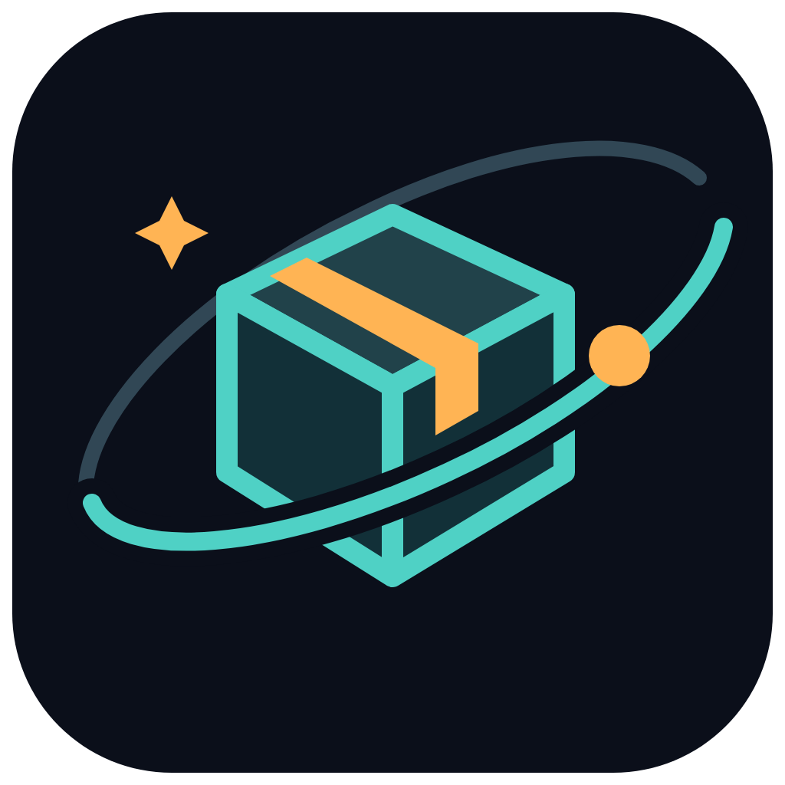

# StatRewards




Earn supply parcels from traders when you hit repeatable milestones in SPT 4.1. Open StatRewards in the SPT web interface to choose how often rewards arrive and what goes in them.

## Features

- **46 milestones in the default configuration** covering kills, damage, healing, looting, economy, exploration, and weapon-type stats
- **Category-based random rewards** — meds, ammo, gear, keys, barter items, money, food, drinks
- **Weapon rewards with attachments** — weapons come with their default preset (stock configuration with base mods)
- **Armor preset rewards** — armor with plates and inserts included
- **Full ammo stacks** — ammo rewards always give a complete stack
- **Per-profile progress tracking** — no retroactive reward flood on first install
- **Varied parcels** mix categories and avoid duplicate items when your reward pool allows it
- **Web settings** let you edit milestones and preview a parcel before saving

## Installation

1. Download the latest release
2. Extract to `SPT_Runtime/user/mods/StatRewards/`
3. Ensure the folder structure is:
   ```
   SPT_Runtime/user/mods/StatRewards/
   ├── StatRewards.dll
   └── config/
       └── mod_config.jsonc
   ```
4. Start SPT server

An alternative config ships in `addons/random_loot/`: all 48 milestones draw 3 random items from one shared pool. Replace `config/mod_config.jsonc` with it if you prefer that.

## How It Works

After each raid, the mod checks your profile's overall stats against configured milestones. When a threshold is crossed, a random reward is generated from the milestone's reward pool and sent via in-game mail from the configured trader.

Milestones are **repeatable** — for example, a milestone set to `"every": 25` for kills will trigger at 25, 50, 75, 100 kills, etc.

On first install, milestones are **seeded** to your current stats so you don't receive a flood of retroactive rewards.

## Web settings

Open **StatRewards** in the SPT web interface (`/statrewards`) with an administrator account. Find a milestone by name or tracked stat to edit its interval, sender, number of draws and reward pool. **Preview parcel** shows up to six sample draws from your item database, including quantities. Click **Save settings** and restart the SPT server to apply your changes.

**Varied parcels** is on by default, including for existing configurations. For example, if a parcel has three draws and its pool offers meds, ammo and roubles, you get one of each. Weights decide between eligible entries. With only meds available, the mod picks different medical items until it runs out of choices. Several triggers of the same milestone delivered in one mail share the same draw history. Turn the option off to draw independently each time.

## Configuration file

To add or remove milestone definitions, edit `config/mod_config.jsonc`. The file supports comments and trailing commas.

### Milestone Structure

```jsonc
{
  "id": "novice_hunter",        // unique identifier
  "stat_key": "Kills",          // OverallCounters key (see DESIGN.md for full list)
  "stat_subkey": null,           // optional second key (e.g. "Survived" for ExitStatus)
  "every": 25,                  // trigger every N of this stat
  "divisor": 1,                 // set to 100 for Float-type counters (damage, heal, blood loss)
  "sender": "54cb50c76803fa8b248b4571",  // trader ID who sends the mail
  "message": "Not bad for a rookie.",     // mail message text
  "reward_count": 2,            // how many items to pick per trigger
  "reward_pool": [              // weighted random pool
    { "category": "meds", "weight": 4 },
    { "category": "ammo", "weight": 3 },
    { "category": "money", "min_stack": 10000, "max_stack": 30000, "weight": 2 }
  ]
}
```

### Reward Categories

| Category | Description |
|----------|-------------|
| `meds` | Random medkit, drug, or stimulator |
| `ammo` | Random ammunition (full stack) |
| `food` | Random food item |
| `drink` | Random drink item |
| `keys` | Random mechanical key (no keycards) |
| `barter` | Random barter item |
| `weapon_preset` | Random weapon with full mod preset |
| `gear` | Random armor, rig, helmet, or backpack (with plates if applicable) |
| `money` | Roubles (use `min_stack`/`max_stack` for amount range) |

You can also use specific item template IDs instead of categories:
```jsonc
{ "template_id": "5449016a4bdc2d6f028b456f", "min_stack": 50000, "max_stack": 100000, "weight": 2 }
```

### Trader IDs

| Trader | ID |
|--------|-----|
| Prapor | `54cb50c76803fa8b248b4571` |
| Therapist | `54cb57776803fa99248b456e` |
| Fence | `579dc571d53a0658a154fbec` |
| Skier | `58330581ace78e27b8b10cee` |
| Peacekeeper | `5935c25fb3acc3127c3d8cd9` |
| Mechanic | `5a7c2eca46aef81a7ca2145d` |
| Ragman | `5ac3b934156ae10c4430e83c` |
| Jaeger | `5c0647fdd443bc2504c2d371` |

### Float-Type Counters

Some stats are stored as `value * 100` internally. Set `"divisor": 100` for these:
- `CauseArmorDamage`, `CauseBodyDamage`, `CombatDamage`
- `Heal`, `BloodLoss`
- `BodyPartDamage.*`

## Building from Source

Requires the .NET 10 SDK and SPT 4.1 server assemblies.

```bash
# Set SPT_DIR to your SPT server root
dotnet build src/StatRewards/StatRewards.csproj -c Release -p:SPT_DIR="C:\Games\SPT-4.1\SPT_Runtime"
```

## Available Stats

See [DESIGN.md](DESIGN.md) for the complete list of 100+ trackable profile stats.

## License

MIT
